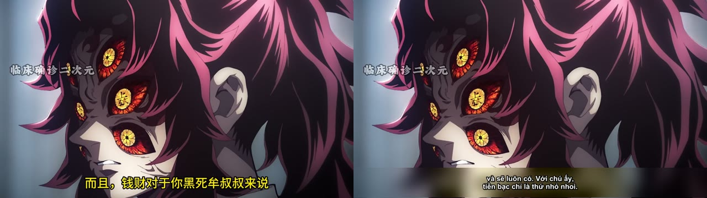
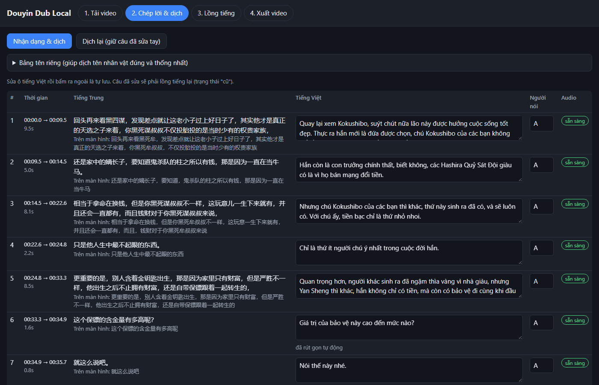
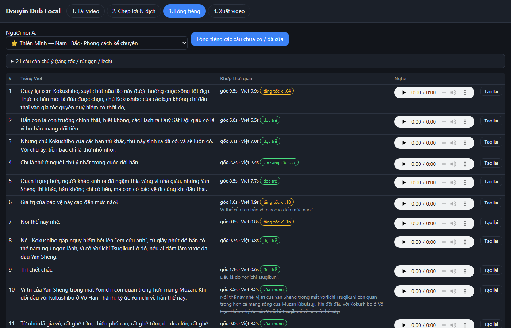
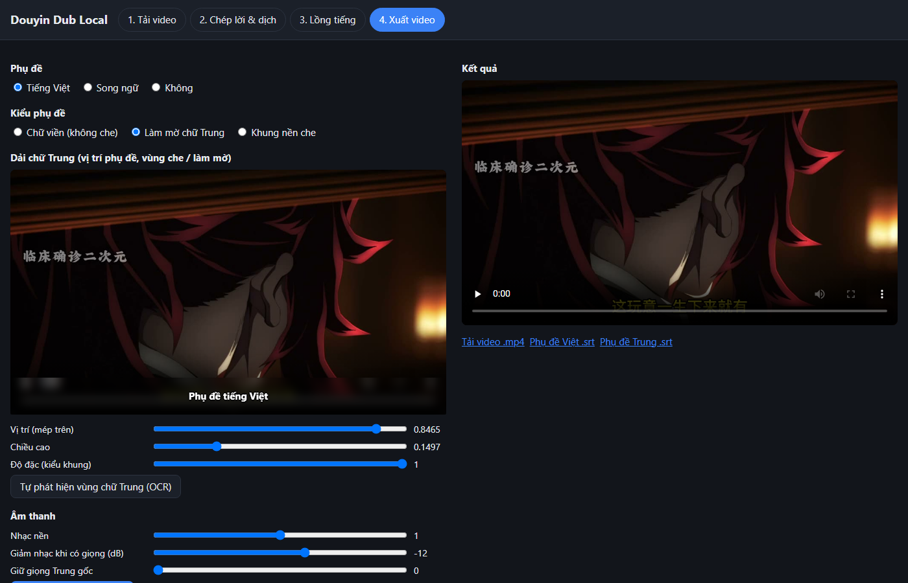

# Douyin Dub Local

Lồng tiếng Việt cho clip ngắn tiếng Trung (Douyin, 15 giây – 3 phút), chạy hoàn toàn trên máy, không dùng API trả phí.
Đầu vào là file video có sẵn → đầu ra là video đã lồng tiếng Việt, giữ nhạc nền gốc, có phụ đề Việt (hoặc song ngữ) trong khung che chữ Trung in sẵn, kèm file `.srt`.

## Demo

Trước (trái) và sau (phải): giọng Việt thay giọng Trung, nhạc nền giữ nguyên, dải chữ Trung in sẵn được làm mờ và thay bằng phụ đề Việt.




**Giao diện web**

| Bước 2: chép lời & dịch | Bước 3: lồng tiếng |
|---|---|
|  |  |

Bước 2: từng câu tiếng Trung (kèm chữ OCR đọc từ phụ đề in sẵn) và bản dịch sửa được, sửa câu nào chỉ câu đó lồng tiếng lại.
Bước 3: chọn giọng cho từng người nói, nghe thử, xem câu nào phải tăng tốc / rút gọn, tạo lại từng câu.



Bước 4: chọn kiểu phụ đề (làm mờ chữ Trung / khung nền / chữ viền), chỉnh vị trí dải chữ ngay trên video xem trước, âm lượng nhạc nền, xuất `.mp4` và `.srt`.

> Clip minh hoạ là video thuyết minh anime của kênh Douyin khác, chỉ dùng để thử nghiệm cá nhân; ảnh trên là vài khung hình thu nhỏ. Video gốc và kết quả không được đưa lên repo.

## Pipeline

| Bước | Việc | Công cụ | Chạy trên |
|---|---|---|---|
| 1 | Tách âm thanh | ffmpeg | CPU |
| 2 | Tách giọng nói / nhạc nền | Mel-Band RoFormer (audio-separator) | GPU, tiến trình con |
| 3 | Nhận dạng tiếng Trung + mốc thời gian | FireRedASR2-AED | GPU, tiến trình con |
| 4 | Phân biệt người nói | CAM++ tiếng Trung (sherpa-onnx) + gom nhóm | CPU |
| – | Tìm vùng chữ Trung in sẵn + đọc chữ trên màn hình | RapidOCR | CPU |
| 5 | Trích bảng tên riêng + dịch Trung → Việt | Qwen3.6-35B-A3B qua Ollama | GPU + RAM |
| 6 | Lồng tiếng Việt | VieNeu-TTS v3 Turbo (ONNX int8) | CPU |
| 7 | Khớp thời gian (xếp theo chuỗi, tăng tốc ≤1.25x, LLM rút gọn) | Python | CPU |
| 8 | Trộn audio (ducking) + phụ đề + xuất video | ffmpeg | CPU |

Clip 3 phút mất khoảng 8–9 phút trên i5-12400F + RTX 5060 8 GB + 32 GB RAM.
Mỗi lúc chỉ một tác vụ GPU; tách giọng và ASR chạy trong tiến trình con nên xong là trả sạch VRAM.

## Cài đặt (Windows)

Cần: Python 3.12, ffmpeg trong PATH, driver NVIDIA mới, [Ollama](https://ollama.com) có model
`hf.co/unsloth/Qwen3.6-35B-A3B-GGUF:UD-Q4_K_M`.

```powershell
py -3.12 -m venv .venv
# PyTorch bản CUDA 12.8 (RTX 50-series). CHỈ dùng index này, không thêm PyPI.
.venv\Scripts\python.exe -m pip install torch torchaudio torchvision --index-url https://download.pytorch.org/whl/cu128
# Các gói còn lại cài riêng (luôn chạy thử với --dry-run để chắc pip không thay torch)
.venv\Scripts\python.exe -m pip install faster-whisper qwen-asr audio-separator audioread vieneu sherpa-onnx rapidocr pypinyin kaldiio kaldi_native_fbank sentencepiece soundfile cn2an textgrid peft
git clone --depth 1 https://github.com/FireRedTeam/FireRedASR2S.git third_party/FireRedASR2S
.venv\Scripts\python.exe check_env.py
```

Model (~16 GB) tải vào `models/` và kho Hugging Face (`HF_HOME`); xem `tests/` để biết cách tải từng model.
Mọi thông số nằm trong `config.yaml`.

## Cách dùng

Dòng lệnh:
```powershell
.venv\Scripts\python.exe run.py clip.mp4
.venv\Scripts\python.exe run.py clip.mp4 --subs bilingual --voice "Ngọc Huyền" --glossary names.json
.venv\Scripts\python.exe run.py --resume <project_id>     # chạy tiếp khi bị lỗi giữa chừng
```

Giao diện web:
```powershell
.venv\Scripts\python.exe app.py      # mở http://127.0.0.1:8000
```
4 bước: tải video → bảng chép lời & bản dịch (sửa được, sửa câu nào chỉ câu đó lồng tiếng lại) →
lồng tiếng (mỗi người nói một giọng, nghe thử, tạo lại từng câu) → xuất video (kiểu phụ đề, khung che, âm lượng).
Có chế độ "Làm hết tự động".

Kết quả ở `outputs/<project_id>/`: `final.mp4`, `final.vi.srt`, `final.zh.srt`, `fit_log.txt`
(câu phải rút gọn / tăng tốc / bị lệch), `segments.json` (từng câu), `log.txt`.

## Thử từng model

`tests/test_asr.py`, `test_separation.py`, `test_translate.py`, `test_tts.py`, `test_diarize.py`:
mỗi script chạy một thành phần trên `tests/sample.mp4` (hoặc dự án mới nhất), in thời gian và VRAM.
